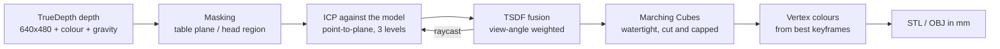

# Depth2Print

**Turn the Face ID camera on your iPhone into a 3D scanner for 3D printing.**

Scan a face, a bust, a person or a small object, and get a watertight STL or a colour OBJ that slices without repair.
Everything runs on the phone's GPU in real time: no cloud upload, no account, no subscription.

[](LICENSE)


<!-- Demo: add docs/demo.gif (scan -> 3D viewer -> printed result) here. -->

## Features

- **Four scan modes**
  - **Face**: hold the phone still and turn your head. Neck and shoulders are cut away automatically and the result is a flat-backed relief, ready to print.
  - **Turntable**: the phone stays still and the object turns. The turntable surface is detected and removed, and the base is closed flat.
  - **Handheld**: walk the phone around an object resting on a table.
  - **Body**: someone walks around you to capture a bust or full body.
- **Real-time KinectFusion-style pipeline in Metal**, running at about 18 processed frames per second on a recent iPhone.
- **Print-ready output.** Meshes are always watertight and manifold, exported in millimetres, and oriented with gravity so the scan stands upright (or a face relief lies on its back) on the print bed.
- **Colour.** The OBJ export includes per-vertex colour, which MeshLab and Blender display.
- **In-app 3D viewer** to orbit, zoom, and turn colour on and off.
- **Live feedback** during the scan: a shaded preview of the model drawn over the camera image, plus optional voice and haptic guidance.
- **Mac test bench** (`Tools/ScanBench`) to run the whole engine on a Mac, against synthetic scenes with known ground truth or against raw captures recorded on a phone.

## How accurate is it?

Measured on a real face scan at about 17 cm:

| | |
|---|---|
| Surface accuracy (fused mesh compared with held-out, noise-averaged sensor depth) | **~0.5 mm median** |
| Finest detail the sensor can resolve | ~1.2–1.6 mm |
| Sensor noise in a single frame | ~1 mm |

On synthetic scenes the engine reconstructs faces to 0.04 mm median and objects to about 0.2–0.3 mm. On real scans the TrueDepth sensor is the limit, so expect nicely detailed busts and faces. Features below about 1.5 mm (fabric weave, a badminton net, fine hair) cannot be captured.

## How it works



1. **Depth capture.** The front TrueDepth camera delivers 640×480 depth, colour and device gravity. Apple's temporal filter is turned off because fusion does a better job of averaging.
2. **Masking.** In turntable mode the support plane is found with RANSAC and removed. In face mode the head is located from gravity and the top of the head, and everything below the neck is cut away.
3. **Tracking.** Each frame is aligned to a raycast of the fused model, not just to the previous frame, using coarse-to-fine projective point-to-plane ICP. The solver is degeneracy-aware and uses a smoothed velocity prior. On a turntable, the rotation axis is fitted and then locked.
4. **Fusion.** The aligned depth is fused into a truncated signed distance field (TSDF). Each voxel is stored as two 16-bit floats, at up to 320³ voxels, about 0.94 mm each for faces. Measurements are weighted by how squarely the camera faced the surface. Space never seen is filled from inside/outside votes, so meshes always close.
5. **Meshing.** GPU Marching Cubes uses lookup tables generated in code with manifold-safe triangulation. Cut planes and a cap make the result watertight, and only the largest connected piece is kept.
6. **Colour.** Up to 80 sharp colour keyframes are kept during the scan. Each vertex takes its colour from the views that saw it most squarely, with occluded views and silhouette edges rejected.

## Getting started

**You need:**
- A Mac with Xcode 16 or later.
- An iPhone with Face ID (iPhone X or newer) on iOS 16 or later.

**Steps:**
1. Clone the repo and open the project:
   ```sh
   git clone https://github.com/tusharfc/Depth2Print.git
   open Depth2Print/Depth2Print.xcodeproj
   ```
2. Select the **Depth2Print** target, open **Signing & Capabilities**, and choose your own Team. The bundle ID is derived from the Team, so this is the only change needed.
3. Plug in your iPhone and press Run. A free Apple ID works; the app then expires after 7 days.

## Scanning tips

- **Light:** use even, soft light. Avoid direct sunlight; its infrared swamps the TrueDepth projector.
- **Distance:** face scans work best at 15–30 cm, objects at 20–60 cm.
- **Speed:** move slowly. If you see "Tracking lost", go back to where tracking was last good.
- **Difficult surfaces:** shiny, black, or transparent surfaces return little depth. Glasses and very fine hair blur.
- **File format:** export **OBJ** to keep colour, or **STL** for the smallest print-only file.

## Mac test bench

ScanBench runs the DepthEngine sources directly on a Mac with Metal, no iPhone needed:

```sh
Tools/ScanBench/run.sh                     # synthetic scenes with ground truth: accuracy, colour, timing
ONLY=face Tools/ScanBench/run.sh           # one scenario
Tools/ScanBench/run.sh replay <capture>    # replay a raw capture recorded in the app
```

To record a capture, turn on **Record raw capture** in the app, scan, then use **Share raw capture**. Replays reproduce the phone's result exactly, so a capture attached to a bug report lets anyone debug it.

## Project layout

```
Depth2Print/          SwiftUI app: camera preview, scan flow, 3D viewer, export
DepthEngine/          Framework, no UI dependencies
  Capture/            TrueDepth session, gravity, raw capture recorder
  Registration/       ICP, frame-to-model tracker
  Fusion/             TSDF volume, Marching Cubes, scene setup, colouring, live preview
  Export/             Mesh, STL/OBJ writer
  Shaders/            Metal kernels
Tools/ScanBench/      Mac test bench (synthetic scenes and capture replay)
```

## Roadmap

Contributions welcome. Good places to start:

- [ ] Mesh decimation and optional smoothing in the app (smaller STLs)
- [ ] Loop closure / global pose refinement for 360° scans
- [ ] Texture-mapped OBJ/USDZ export in addition to vertex colour
- [ ] Lens distortion correction from `AVCameraCalibrationData`
- [ ] Rear LiDAR mode for large objects and rooms

## Contributing

Open an issue with a raw capture attached (see [Mac test bench](#mac-test-bench)) for any scan that came out wrong. Pull requests should keep `Tools/ScanBench/run.sh` passing and the iOS build free of warnings.

## License

[GPL-3.0](LICENSE) © Tushar Kumar
